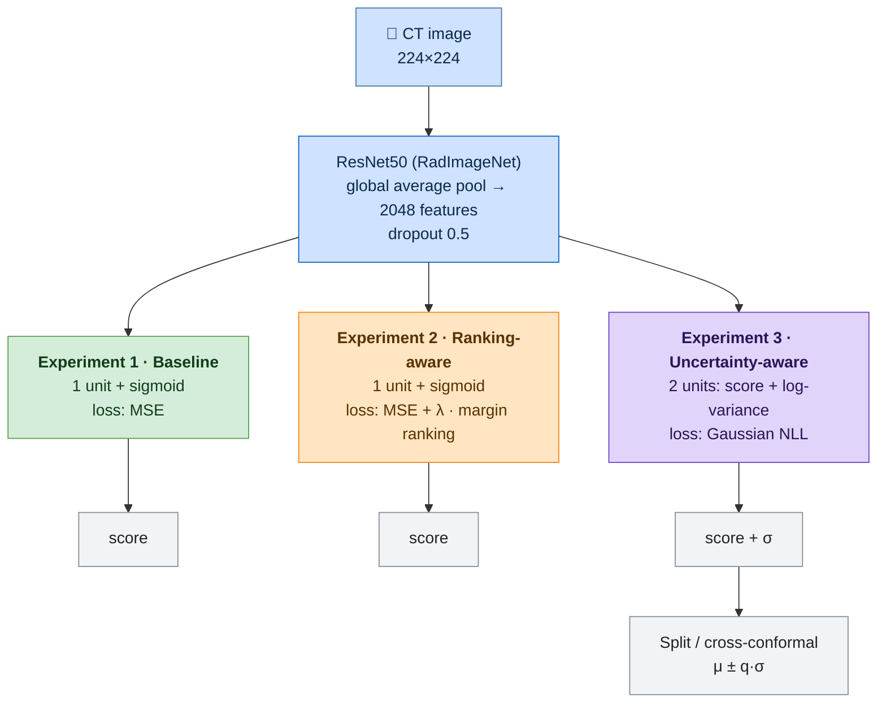
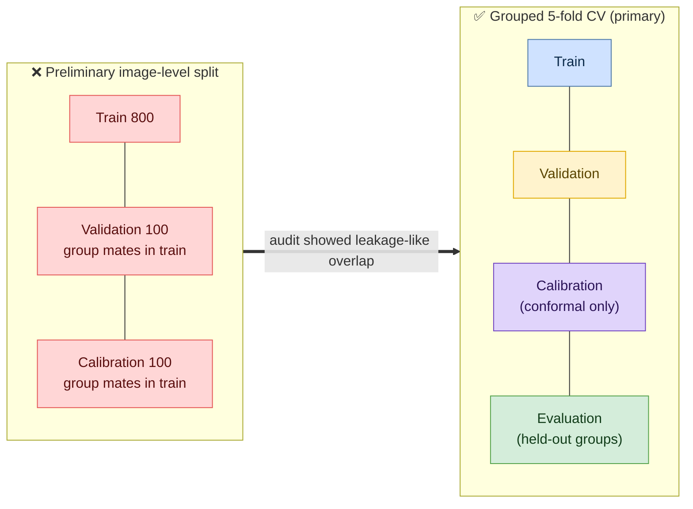
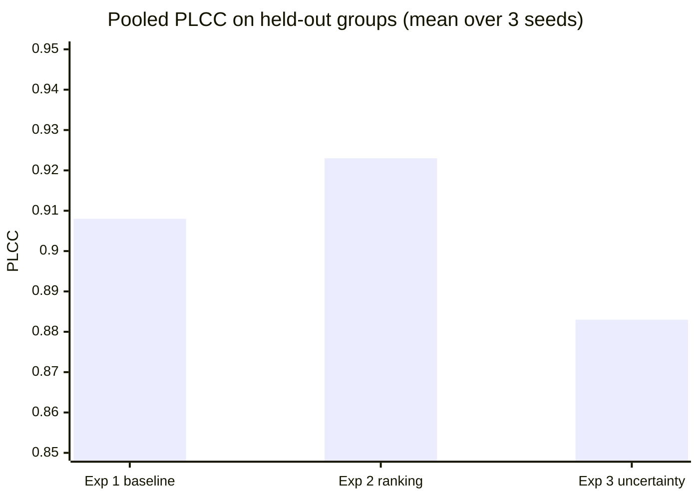
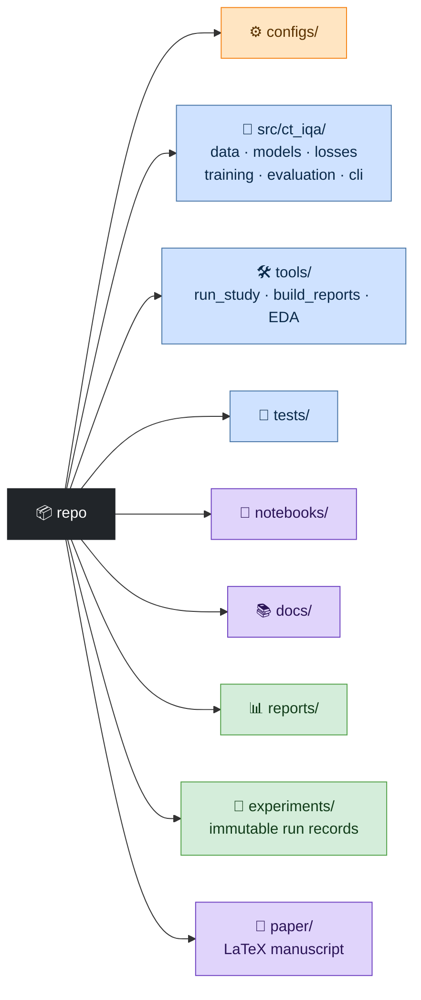

<div align="center">

# 🩻 Quality-Aware Lung CT

### No-reference CT image quality assessment with a RadImageNet-pretrained ResNet50

*A controlled comparison of **regression**, **ranking-aware regression** and **uncertainty-aware regression** under a frozen, pre-declared protocol.*


**[Overview](#-overview) · [Pipeline](#-pipeline-at-a-glance) · [Experiments](#-the-three-experiments) · [Dataset](#-dataset-and-splits) · [Results](#-results) · [Limitations](#-limitations) · [Quick start](#-quick-start) · [Paper](#-paper)**

</div>

---

## 🔭 Overview

A **no-reference** model scores the diagnostic quality of a CT image (0 = worst, 4 = best, radiologist consensus) **without a clean reference image**.
This repository trains and evaluates three ResNet50 variants on the LDCT-IQAC data under one fixed protocol, and reports honestly what the evidence does and does not support.

> ⚠️ This is a research code base for an intra-college study, **not a clinical tool**. Predicting a quality score is not diagnostic performance.

| | |
|---|---|
| 🎯 **Task** | Predict the mean radiologist quality score (0 to 4) from one CT image |
| 🧠 **Model** | ResNet50, RadImageNet weights, sigmoid head |
| 🧪 **Questions** | Does a ranking loss help? Does a learned uncertainty give useful conformal intervals? |
| 🧱 **Protocol** | Frozen before the runs, grouped 5-fold CV, 3 seeds, group bootstrap |

---

## 🗺️ Pipeline at a glance

```mermaid
flowchart LR
    subgraph D["1 · Data"]
        A["🗂️ LDCT-IQAC<br/>1000 labelled + 300 test"]:::data --> B["✂️ 224×224 centre crop<br/>scale to [-1, 1]<br/>gray → 3 channels"]:::data
    end
    subgraph G["2 · Grouping and splits"]
        C["🔗 54 similarity groups<br/>(NOT patient IDs)"]:::warn --> E["🧩 Grouped 5-fold CV<br/>× 3 seeds = 45 runs"]:::split
    end
    subgraph M["3 · Model and training"]
        F["🧠 ResNet50<br/>RadImageNet + dropout 0.5"]:::model --> H1["Exp 1 · MSE"]:::loss
        F --> H2["Exp 2 · MSE + ranking"]:::loss
        F --> H3["Exp 3 · Gaussian NLL"]:::loss
    end
    subgraph I["4 · Inference"]
        J["📈 Predicted score"]:::out
        K["🎚️ Conformal interval<br/>90% target"]:::out
    end
    subgraph V["5 · Evaluation"]
        L["📊 PLCC · SROCC · KROCC · RMSE"]:::eval
        N["🛡️ Coverage and width"]:::eval
        O["🎲 Group bootstrap<br/>2000 draws"]:::eval
    end
    B --> C
    E --> F
    H1 --> J
    H2 --> J
    H3 --> J
    H3 --> K
    J --> L
    K --> N
    L --> O
    N --> O

    classDef data fill:#cfe2ff,stroke:#4C78A8,color:#0b2a4a
    classDef warn fill:#ffd6d6,stroke:#E45756,color:#5a0f0f
    classDef split fill:#e2e3e5,stroke:#6c757d,color:#222
    classDef model fill:#cfe2ff,stroke:#0A66C2,color:#0b2a4a
    classDef loss fill:#ffe5c2,stroke:#F58518,color:#5a3200
    classDef out fill:#e0d4fb,stroke:#6f42c1,color:#2b1457
    classDef eval fill:#d4edda,stroke:#54A24B,color:#123d1a
```



---

## 🧪 The three experiments

All three share the same backbone, optimiser and checkpoint rule. Only the head and loss change.



| Experiment | Repo label | Question | Headline outcome (grouped evaluation) |
|---|:---:|---|---|
| 🟢 **1 · Baseline** | A | How well does ResNet50 + sigmoid head (MSE) predict the score? | PLCC **0.908**, RMSE 0.454 |
| 🟠 **2 · Ranking-aware** | B | Does a pairwise ranking loss help rank correlation without hurting error? | PLCC **0.923**, RMSE 0.415, **small, seed-dependent gain** |
| 🟣 **3 · Uncertainty-aware** | C | Does a Gaussian-NLL head plus conformal intervals give useful uncertainty? | PLCC 0.883, intervals near target but **no better than constant width** |

<details>
<summary><b>⚙️ Training and selection details</b></summary>

- **Model:** ResNet50 (v1 stride placement, BatchNorm epsilon 1.001e-5 from the weight file), RadImageNet weights (SHA-256 verified), global average pooling, dropout 0.5, one linear unit and sigmoid. Experiment 3 adds a second unit for the clamped log-variance.
- **Experiment 2 loss:** MSE + λ × pairwise margin ranking over in-batch pairs whose label gap is at least δ. Settings (λ = 1.0, margin = 0.05, δ = 0.5) were chosen on fold 0, seed 42 by a rule declared before any run.
- **Experiment 3 intervals:** μ ± q·σ with the quantile from calibration groups (target coverage 0.90), in a grouped split-conformal (main) and a grouped cross-conformal (secondary) version, plus a constant-width comparator.
- **Training (identical for all):** Adam, lr 1e-3, batch 64, 30 epochs, no augmentation or scheduler, checkpoint = best validation PLCC.
- **Seeds:** 42 = selection only; 1, 2, 3 = independent final replicates.
- **Test boundary:** the official test set is read only once per final model, after the protocol is frozen, and is reported as **retrospective**.
- Full protocol: [EXPERIMENT_PROTOCOL](docs/methodology/EXPERIMENT_PROTOCOL.md), [STUDY_V3_PROTOCOL](docs/methodology/STUDY_V3_PROTOCOL.md), preprocessing evidence: [PREPROCESSING](docs/methodology/PREPROCESSING.md).

</details>

---

## 🗃️ Dataset and splits

**LDCT-IQAC:** 1000 labelled training images (512×512 float32 TIFF, scores in [0, 4]) and a 300-image official test set. The images are **not redistributed** here; only label files are tracked (`data/labels/ldct_iqac/`).

**Preprocessing:** 224×224 centre crop (not a resize), `2x − 1` scaling to [-1, 1], grayscale copied to three channels. Targets are divided by 4 (sigmoid output) and predictions are scaled back to [0, 4].

### 🧩 Why grouped evaluation?

The labelled images are repeated renderings of the same content at different quality levels. An image-level split therefore puts near-identical images on both sides.
We measured this (groups of exactly 10 near-identical images), built **54 similarity groups** and evaluate with grouped folds.



> 🔎 **Groups are image-similarity sets, not patient IDs.** No patient identifiers exist, so patient-level independence is not established. See [DATASET_AND_EDA](docs/methodology/DATASET_AND_EDA.md) and the [split audit](docs/audit/SPLIT_AND_CALIBRATION_AUDIT.md).

---

## 📊 Results

### 🥇 Primary: grouped evaluation (held-out groups, pooled, mean ± SD over 3 seeds)

Details: [STUDY_V3_RESULTS](docs/experiments/STUDY_V3_RESULTS.md).

| Model | PLCC ↑ | SROCC ↑ | KROCC ↑ | RMSE ↓ | MAE ↓ |
|---|---|---|---|---|---|
| 🟢 Experiment 1 | 0.908 ± 0.035 | 0.914 ± 0.028 | 0.759 ± 0.045 | 0.454 ± 0.083 | 0.358 ± 0.061 |
| 🟠 Experiment 2 | **0.923 ± 0.027** | **0.927 ± 0.023** | **0.779 ± 0.038** | **0.415 ± 0.071** | **0.328 ± 0.058** |
| 🟣 Experiment 3 | 0.883 ± 0.039 | 0.886 ± 0.041 | 0.722 ± 0.056 | 0.510 ± 0.094 | 0.390 ± 0.070 |



**How to read this**
- ✅ Experiment 2 beats Experiment 1 under the declared group-bootstrap rule (mean correlation **+0.016**, 97.5% interval [+0.005, +0.024]; RMSE −0.039).
- ⚠️ The gain is **not consistent across seeds** (+0.034, +0.017, −0.002) and is smaller than the seed-to-seed spread, so only a **small, seed-dependent benefit** is supported.
- ➖ Experiment 3 is **not shown to differ** from Experiment 1.

### 🛡️ Uncertainty (Experiment 3, conformal, target 0.90)

| Interval | Coverage (held-out groups) | Mean width (0 to 4 scale) |
|---|:---:|:---:|
| Grouped split-conformal (main) | **0.919** (95% CI 0.900 to 0.940) | about 1.7 to 1.8 |
| Grouped cross-conformal | 0.893 | about 1.6 to 1.9 |
| Constant width (comparator) | 0.916 | about 1.6 to 1.9 |
| *Official test set (descriptive)* | *0.756* | *1.82* |

Intervals reach near-target coverage once calibration is grouped, but they are **wide**, and a **constant-width interval does just as well**, so the learned uncertainty shows no demonstrated advantage.

### 🕰️ Preliminary image-level evaluation (kept for transparency)

Earlier runs used a frozen image-level 800/100/100 split. Validation scores were very high (PLCC about 0.98) but **optimistic** because every validation and calibration image had a near-identical group mate in training; no test image did.

| Model | Validation PLCC (n=100) | Official test PLCC (n=300, retrospective) | Test RMSE |
|---|:---:|:---:|:---:|
| Experiment 1 | 0.978 ± 0.001 | 0.868 ± 0.009 | 0.596 ± 0.054 |
| Experiment 2 | 0.979 ± 0.001 | 0.869 ± 0.009 | 0.637 ± 0.031 |
| Experiment 3 | 0.974 ± 0.000 | 0.865 ± 0.012 | 0.592 ± 0.040 |

Conformal intervals calibrated on that split reached only **0.64** coverage on the official test set (target 0.90), the failure that led to the grouped evaluation. Full tables: [COMPARATIVE_ANALYSIS](docs/experiments/COMPARATIVE_ANALYSIS.md), [ERROR_ANALYSIS](docs/experiments/ERROR_ANALYSIS.md), [`reports/`](reports/).

*Historical runs 001 to 003 (earlier protocol with a BatchNorm epsilon mismatch) are preserved unchanged and are not part of the claims.*

---

## ⚠️ Limitations

| | |
|---|---|
| 🧑‍⚕️ **No patient IDs** | Groups are similarity proxies; patient-level independence is not established |
| 🔁 **Test set seen before** | The official test set is retrospective and descriptive only |
| 🎲 **Few seeds and groups** | 3 seeds and at most 54 groups; bootstrap intervals may be too narrow |
| 📐 **Selection effects** | Experiment 2 settings were chosen on a few fold-0 groups |
| 🎚️ **Calibration** | 6 to 8 calibration groups per fold give noisy coverage; exchangeability fails on the official test set |
| 🏷️ **Labels and data** | Rater averages, one dataset, `2x−1` scaling is an assumption |

Nothing here is evidence of clinical utility and no claim of novelty is made. See [limitations-and-threats](docs/limitations-and-threats.md).

---

## 🗂️ Repository structure



<details>
<summary><b>📁 Folder details</b></summary>

```
configs/        base.yaml + experiments/{a,b,c}_*.yaml; legacy YAMLs for runs 001-003
src/ct_iqa/     data, preprocessing, models, losses, training, evaluation (metrics, bootstrap, conformal), experiment, cli
tools/          run_eda.py, preprocessing_probe.py, run_study.py, select_b.py, build_reports.py, create_split_manifest.py
tests/          unit / regression / integration
notebooks/      00-07: audit, EDA, preprocessing, experiments, comparison, error analysis (training gated off by default)
docs/           methodology, experiment specs and analyses, decision records, audit, reproducibility
reports/        eda/, preprocessing_probe/, experiments/ (generated from raw run records)
experiments/    historical 001-003 (immutable) and study run records (checkpoints are not committed)
weights/        pretrained weights (not committed)
paper/          LaTeX manuscript (Elsevier cas-sc)
```

</details>

---

## 🚀 Quick start

Environment used for the reported runs: Python 3.10, PyTorch 2.5.1 + CUDA 12.1, one RTX 4060 Laptop GPU (8 GB), Windows 11, about 5 to 8 minutes per 30-epoch run.
Get the dataset and the RadImageNet weights as described in [`docs/reproducibility.md`](docs/reproducibility.md) and [`weights/pretrained/radimagenet/resnet50/README.md`](weights/pretrained/radimagenet/resnet50/README.md), then:

```bash
pip install -e ".[dev]"
python -m pytest -q                                              # synthetic mechanics; some tests need real data/weights
python -m ct_iqa.cli validate-config --config configs/experiments/a_reference.yaml
python tools/run_eda.py && python tools/preprocessing_probe.py
python tools/run_study.py --exp A --seed 1 --purpose final       # one 30-epoch run (nothing trains on import)
python tools/build_reports.py                                    # regenerate all tables and figures from run records
```

Every run writes an immutable directory with a config snapshot, a run manifest (git state, hashes, versions, seed), history, predictions and artifact checksums.
Full command sequence: [`docs/reproducibility.md`](docs/reproducibility.md).

---

## 📝 Paper

A full manuscript (Elsevier `cas-sc` LaTeX, 9 pages) is in [`paper/`](paper/). Build it with:

```bash
cd paper
pdflatex paper && bibtex paper && pdflatex paper && pdflatex paper
```

---

## 🔍 Scientific transparency

- 📜 Selection rules were written **before** results.
- 🧾 Failed and exploratory runs are kept and labelled.
- 🚫 The official test set was never used for any choice.
- 📉 Differences within bootstrap noise are reported as such.
- 📚 Methodological sources: [`docs/PROVENANCE.md`](docs/PROVENANCE.md).

## 🏁 Conclusion

With the available data, the ranking loss gives at most a **small, seed-dependent** improvement over a plain ResNet50 regressor, and the learned uncertainty is **not shown to beat a constant-width interval**.
The most important caveat is the near-duplicate structure of the labelled images, which makes image-level validation optimistic and calls for patient-level data before any stronger claim.

## 📄 License

Code is MIT-licensed ([`LICENSE`](LICENSE)). The LDCT-IQAC dataset and RadImageNet weights remain under their own terms and are not redistributed.
