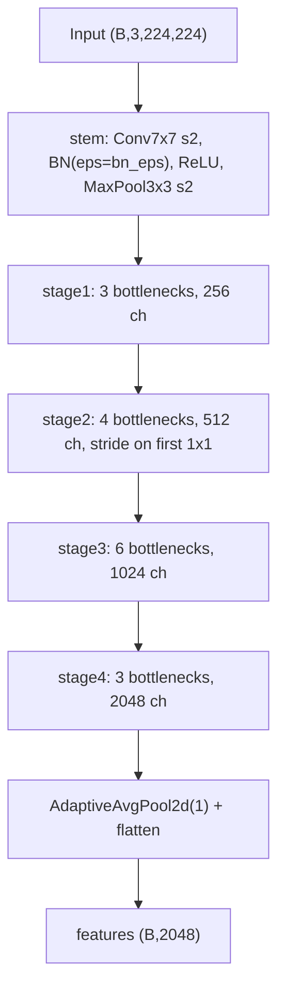
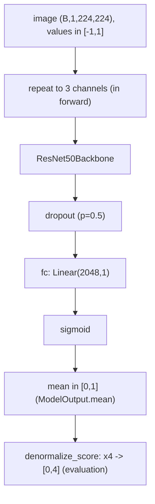
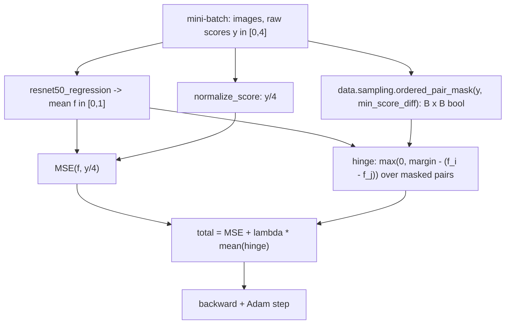
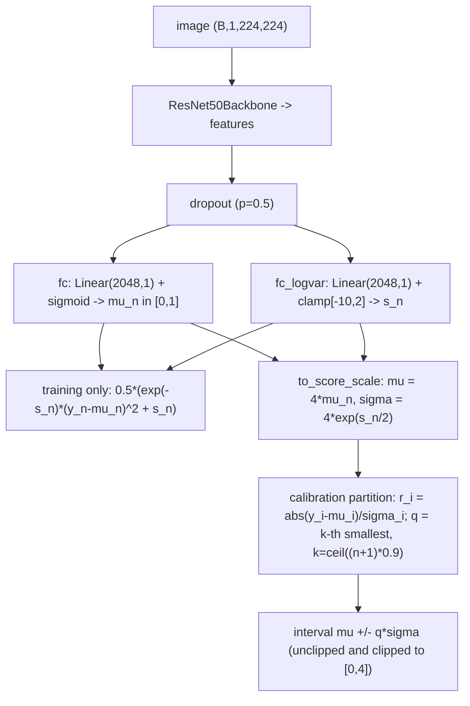
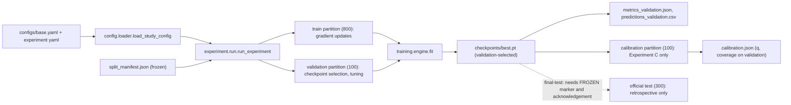
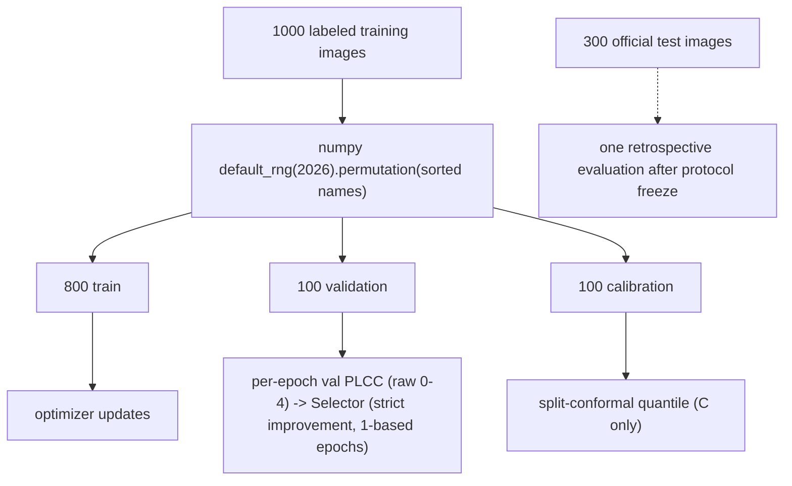
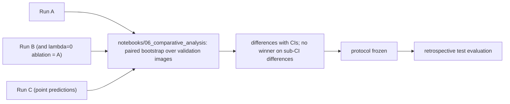

# Model architecture and pipelines

Diagrams use module and function names that exist in the code (checked 2026-10-16 against
`src/ct_iqa/`). Training-only components are marked.

## 1. Shared backbone (`models.backbone.ResNet50Backbone`)

53 BatchNorm layers, all constructed with the same `bn_eps` (1.001e-5 in study v2).

## 2. Experiment A: regression forward pass (`models.registry.ResNet50Model`, head kind `regression`)

State-dict keys: `backbone.*`, `fc.weight`, `fc.bias`, identical to the historical `OhashiResNet50`
(verified structurally for all six checkpoints, see [audit/CHECKPOINT_COMPATIBILITY.md](audit/CHECKPOINT_COMPATIBILITY.md)).

## 3. Experiment B: ranking-aware training path (training only)

At inference the ranking branch does not exist; the model is the same as in Experiment A.
With `lambda_rank = 0` the total equals the MSE term (unit-tested value and gradient).

## 4. Experiment C: mean / log-variance model and calibration

A single deterministic head models aleatoric (data) uncertainty only; no epistemic uncertainty is estimated.

## 5. End-to-end pipeline and data access (`experiment.run.run_experiment`)

The dashed edge is the only path to the official test set; `run_experiment` and `fit` contain no reference to it
(regression-tested).

## 6. Data splitting and checkpoint selection

## 7. Experiment comparison workflow

