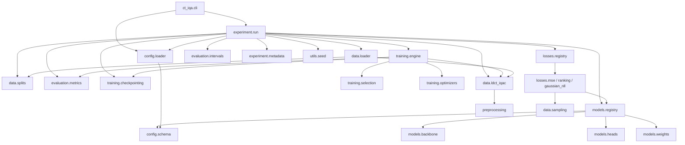

# Repository architecture

All reusable code is in the installable package `src/ct_iqa/`. Notebooks and CLI call it; they never define models,
losses or trainers.

## Module responsibilities

| Package / module | Responsibility |
|---|---|
| `ct_iqa.config.schema`, `config.loader` | Typed `StudyConfig`, strict YAML loading (base + experiment overlay), validation |
| `ct_iqa.config.legacy` | Original flat `ExperimentConfig` for historical experiments 001-003 (re-exported as `ct_iqa.config.ExperimentConfig`) |
| `ct_iqa.models.backbone` | Custom ResNet50 (`ResNet50Backbone`), explicit `bn_eps` |
| `ct_iqa.models.heads` | Head layers: regression, Gaussian mean/log-variance, log-variance clamp |
| `ct_iqa.models.registry` | `resnet50_regression`, `resnet50_gaussian`; `ModelOutput`; `build_model` |
| `ct_iqa.models.weights` | Checksum-verified loading of converted RadImageNet weights |
| `ct_iqa.models.radimagenet_weights` | Keras `.h5` to PyTorch conversion (unchanged) |
| `ct_iqa.models.ohashi_resnet50` | **Legacy** `OhashiResNet50`, kept unchanged for historical checkpoints/notebooks |
| `ct_iqa.data.ldct_iqac` | Dataset, label validation, score (de)normalization |
| `ct_iqa.data.splits` | Historical 90/10 split (unchanged) and the frozen 800/100/100 manifest tools |
| `ct_iqa.data.sampling` | In-batch ordered pair mask for the ranking loss |
| `ct_iqa.data.loader` | Historical loaders (unchanged) and manifest-based study loaders |
| `ct_iqa.preprocessing` | Center crop, `2x - 1` normalization |
| `ct_iqa.losses` | `mse`, `mse_ranking`, `gaussian_nll`, registry |
| `ct_iqa.training.engine` | The single training/validation loop |
| `ct_iqa.training.selection` | Checkpoint-selection policies |
| `ct_iqa.training.checkpointing` | Historical helpers (unchanged) and atomic run checkpoints |
| `ct_iqa.training.trainer` | **Legacy** loop, kept for historical notebooks |
| `ct_iqa.evaluation` | Correlation/point metrics, 5PL mapping (separate), conformal intervals |
| `ct_iqa.experiment.run`, `metadata` | Run orchestration, provenance, guarded final test evaluation |
| `ct_iqa.cli` | `validate-config`, `train`, `evaluate`, `final-test` |

## Dependency diagram

Legacy modules (`models.ohashi_resnet50`, `training.trainer`, `config.legacy`, the historical functions in `data.loader`,
`data.splits`, `training.checkpointing`) are deliberately outside this graph. No study-v2 model, loss or training code
imports `ohashi_resnet50` or `trainer`. Two residual links to the legacy config exist and are not drawn: `data.ldct_iqac`
imports `DEFAULT_IMAGE_SIZE` (used only as a default argument) and `data.loader` imports `ExperimentConfig` (for its
historical functions) from `ct_iqa.config`, which re-exports them from `config.legacy`. `DEFAULT_IMAGE_SIZE` is read from
`configs/preprocessing.yaml` relative to the working directory at import time, so the package should be used from the
repository root.

## Notebooks versus source

Notebooks in `notebooks/` import `ct_iqa` and read run directories. The historical 001-003 notebooks, their generator scripts and `results/` were removed from the working tree
(see [ARCHIVED_ARTIFACTS](ARCHIVED_ARTIFACTS.md)).

## Where things live

`configs/` (YAML), `experiments/00x_*` (historical, immutable), `experiments/study_v2/` (protocol and new runs),
`results/` (historical figures/tables/metrics), `docs/`, `tests/{unit,integration,regression}`, `weights/pretrained/`
(ignored binaries, tracked README and checksums), `data/labels/` (tracked), `data/raw/` (ignored images).

Deviations from the proposed target tree (see [audit/MIGRATION_MAP.md](audit/MIGRATION_MAP.md)): the engine is
`training/engine.py` (the legacy `trainer.py` is kept); `models/radimagenet_weights.py` stays in place and is
re-exported from `models/weights.py`; `utils/seed.py` is reused instead of a new `utils/reproducibility.py`;
no `utils/logging.py` (standard `logging` is used); `calibration` lives in `evaluation/intervals.py`.
